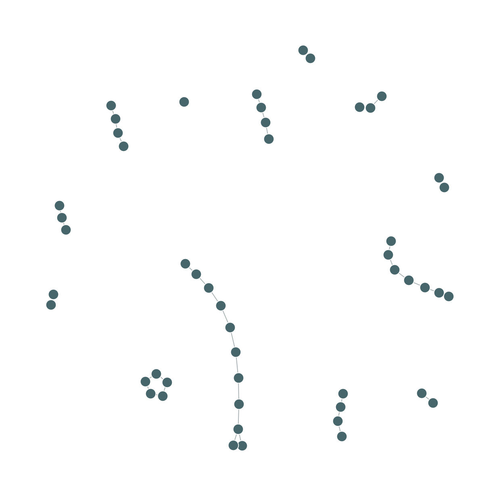
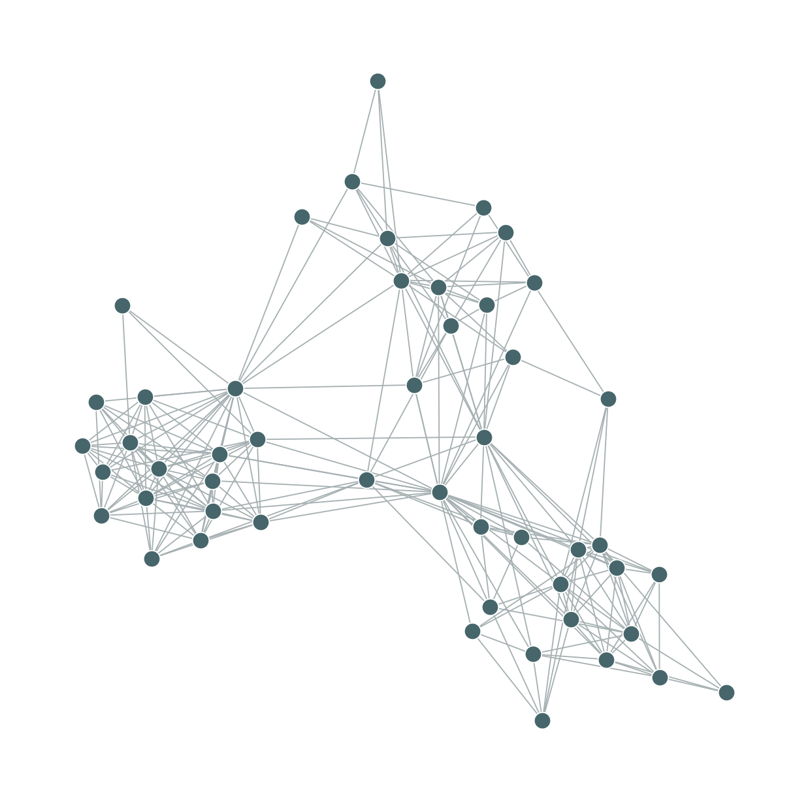
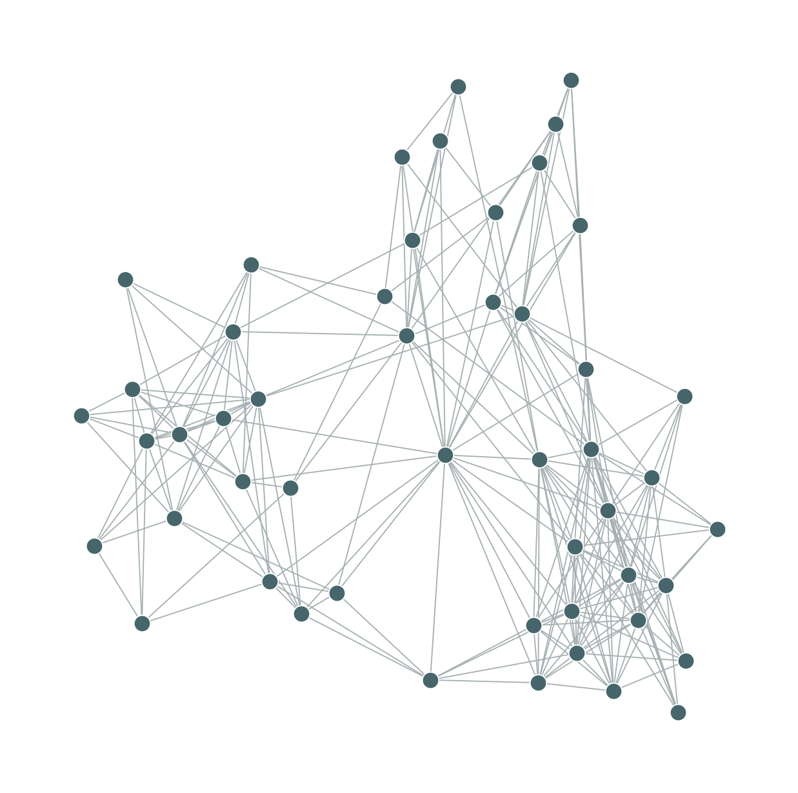
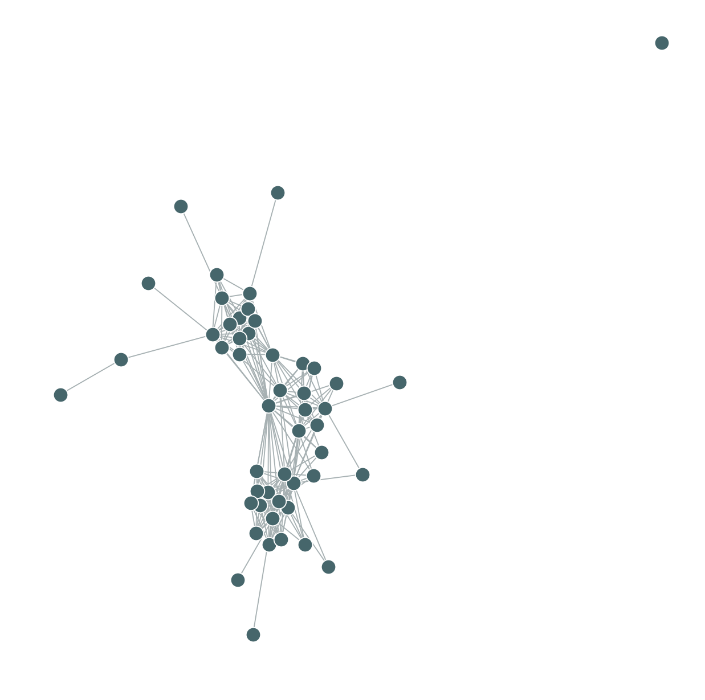

# Browse All 896 Saved Networks

**890 original primary networks + six separately labeled supplements.**
The primary study remains 890 valid graphs out of 896 attempts, including 12 valid empty graphs.
All original six failures remain recorded. Supplements never enter primary statistical tests.

Every row below links to the actual adjacency file and original PNG in this repository.
The large response JSON records remain in the [verified public release](https://github.com/hemu77/UA_Capstone/releases/tag/main-study-20261105).

| Primary Method | Saved Networks | Browse Files |
| --- | ---: | --- |
| Global | 219 | [All graphs and PNGs](docs/network_catalog/global.md) |
| Local | 224 | [All graphs and PNGs](docs/network_catalog/local.md) |
| Sequential | 224 | [All graphs and PNGs](docs/network_catalog/sequential.md) |
| Iterative | 223 | [All graphs and PNGs](docs/network_catalog/iterative.md) |

[Browse the six separate supplemental graphs](docs/network_catalog/supplemental.md).
[All nine retained failures: six primary and three supplemental](outputs/analysis_ready/060dcd3a86d5/failures.csv).
[Machine-readable 896-network catalog and hashes](outputs/analysis_ready/060dcd3a86d5/all_valid_graphs_descriptive_only.csv).

## Example Original Plots

### Global

### Local

### Sequential

### Iterative

