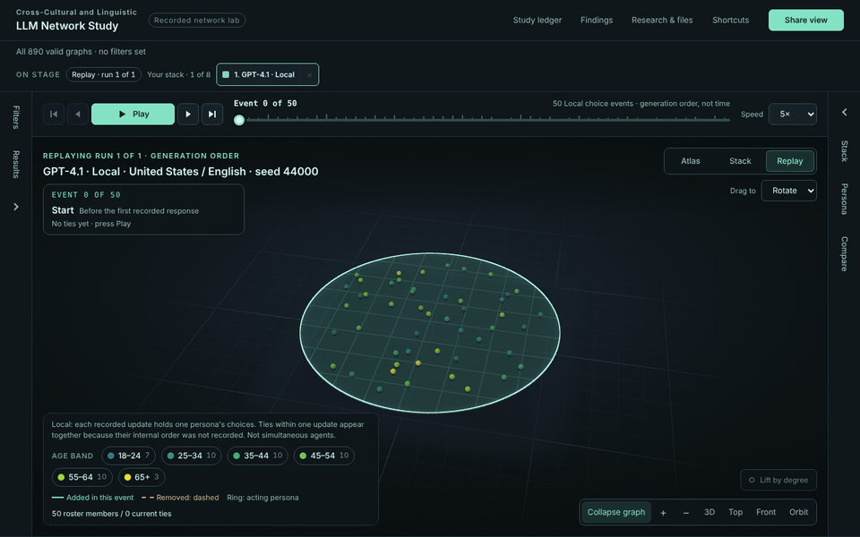
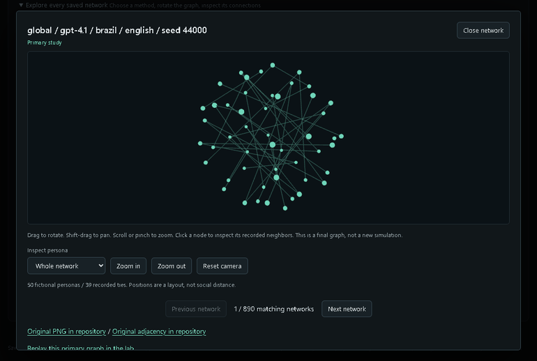
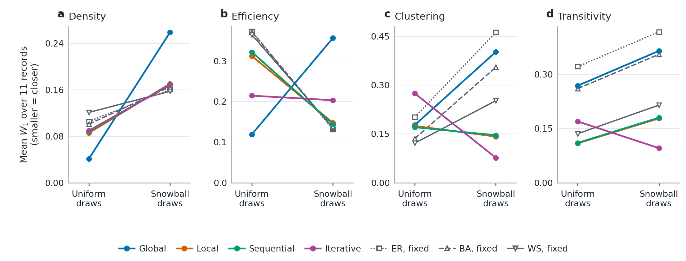

# Cross-Cultural and Linguistic LLM Network Study

When a language model generates a friendship network that matches a real one on some statistic, what has been shown?

We held a roster of 50 fictional adults fixed and asked four model configurations to generate friendships under four procedures and seven country-framing or instruction-language settings. Every result here is a saved model output; nothing on the site calls a model. The study extends [Stanford SNAP's social-network generator](https://github.com/snap-stanford/llm-social-network).

**[Open the live 3D viewer](https://hemu77.github.io/UA_Capstone/layers.html)** · **[Read the research brief](docs/PROFESSOR_RESEARCH_BRIEF.md)** · **[Paper source](paper/icml2026/)**

[](https://hemu77.github.io/UA_Capstone/layers.html)

*Atlas: 112 conditions × 8 seeds. Click a tower to stack its eight seeds as planes.*

[](https://hemu77.github.io/UA_Capstone/layers.html)

*Replay follows recorded generation order, not elapsed time.*

[](https://hemu77.github.io/UA_Capstone/layers.html)

*Drag to rotate; select a person to inspect their neighbors.*

## What we asked and what we found

| | Question | Answer |
| --- | --- | --- |
| RQ1 | Do country framing and instruction language change the generated networks? | Hardly. One of 24 planned contrasts passed correction (Iterative, US-Hindi vs US-English clustering, −0.0453), and it held in only 3 of 8 leave-one-block-out fits. Runs under a different setting share about as many ties with the reference as repeated reference runs share with each other. |
| RQ2 | Does the generation procedure change which attribute organises ties? | Yes, and it reverses the order. Politics is the most sorted attribute when models nominate person by person; religion is when the whole network is generated at once. |
| RQ3 | Is a close structural match about the generator, or about its edge count? | Mostly edge count for reachability, not for closure. Giving a random-edge generator each record's density closes 87% of its efficiency gap to whole-network generation, yet it stays the worst candidate on clustering on average. |
| RQ4 | Does the verdict depend on how the observed network was sampled? | Yes. With uniform 50-node samples of eleven observed records, whole-network generation is closest on efficiency in 9. With snowball samples of the same records it is closest in 0. |



Only the 24 framing contrasts were planned in advance. The mixing, density and sampling analyses were run afterwards and are exploratory.

### Limits

- One fictional roster; religion and politics are associated on it.
- The order of attribute fields in the prompt was fixed.
- Procedures were not compute-matched: person-level procedures used roughly 50 to 350 times as many requests as whole-network generation.
- Eight schedule blocks per condition.
- These are results about generated graphs. They are not claims about real people's friendships, about Hindi speakers, or about any national population.

## The data

| | Count |
| --- | --- |
| Planned primary attempts (4 models × 4 procedures × 7 settings × 8 seeds) | 896 |
| Valid primary graphs | 890 |
| — of which valid with no ties | 12 |
| Failed attempts, kept as failures | 6 |
| Supplemental graphs, kept separate | 6 |

The six supplemental graphs come from nine later attempts. They are viewable separately and never replace a failure or enter any statistic.

<details>
<summary>Preview switching between primary and supplemental graphs</summary>


</details>

## Where things are

| To review | Start here |
| --- | --- |
| Questions, findings, effect sizes and limits | [Research brief](docs/PROFESSOR_RESEARCH_BRIEF.md) |
| The manuscript | [paper/icml2026/](paper/icml2026/) |
| Statistics, demographic mixing and real-world comparisons | [Six executed notebooks](analysis/README.md) · [Reproduction guide](ANALYSIS_START_HERE.md) |
| Robustness and tie-level checks | [Results note](docs/research/ROBUSTNESS_CHECKS_V3.md) |
| Manuscript figures and the values behind them | [19 reviewed figures, v6.2](outputs/publication_figures/20261118_v6_2/) |
| Primary graphs, failures and comparison tables | [Results index](outputs/README.md) · [Individual graph files](NETWORKS.md) |
| Build or verify the viewer locally | [Viewer guide](docs/SIMULATOR_DEPLOYMENT.md) |

## Reproduce

The offline checks reuse the saved graphs and public records. They make no model or network calls and write only to a new directory.

```bash
python scripts/run_robustness_checks.py --output outputs/research_extension/<new-folder>   # about one minute
python scripts/run_tie_level_checks.py  --output outputs/research_extension/<new-folder>   # under ten seconds
```

```bash
cd viewer && npm ci && npm run build && npm test && npm run verify:public
```

## Archives

Large response archives are in the [verified study release](https://github.com/hemu77/UA_Capstone/releases/tag/main-study-20261105). Earlier work is in two archive folders: [older reports and plans](docs/history/older/) and [calibration results](docs/history/calibration/). Sealed evidence stays at its recorded paths so historical checks still resolve.
