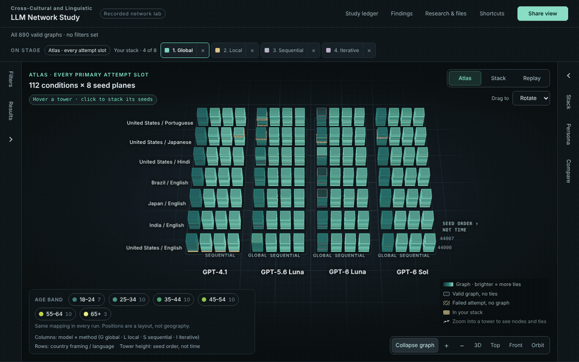
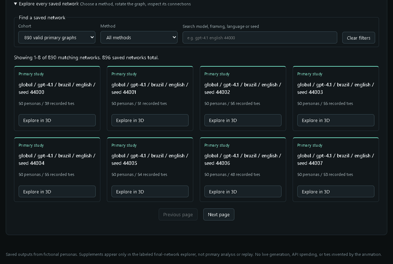

# Cross-Cultural and Linguistic LLM Network Study

How does a language model decide who becomes friends? We held a roster of 50 fictional adults fixed and varied the model, generation method, country framing and instruction language. The study extends [Stanford SNAP's social-network generator](https://github.com/snap-stanford/llm-social-network).

**[Open the live 3D demo](https://hemu77.github.io/UA_Capstone/layers.html)** · **[Browse saved networks](https://hemu77.github.io/UA_Capstone/layers.html#saved-plots)** · **[Read the research brief](docs/PROFESSOR_RESEARCH_BRIEF.md)**

*Atlas: 112 conditions × 8 seeds — 890 valid graphs (12 empty) and 6 failures shown as failures. Click a tower to stack its seeds.*

*Replay shows recorded generation order, not elapsed time. The edges are saved study results, not a live simulation or a new model call.*

## Research for the paper

| To review | Start here |
| --- | --- |
| Questions, findings, effect sizes and limits | [Professor's research brief](docs/PROFESSOR_RESEARCH_BRIEF.md) |
| Statistics, demographic mixing and real-world comparisons | [Six executed notebooks](analysis/README.md) · [Reproduction guide](ANALYSIS_START_HERE.md) |
| Manuscript plots and the values behind them | [19 reviewed figures, v6.2](outputs/publication_figures/20261118_v6_2/) |
| Primary graphs, failures and comparison tables | [Current results index](outputs/README.md) · [Individual graph files](NETWORKS.md) |
| Build or verify the demo locally | [Viewer guide](docs/SIMULATOR_DEPLOYMENT.md) |

Across the real-network comparisons, no method was closest on every metric. Matching the observed density explained much of the apparent advantage in reachability, and sampling changed which network structures were visible. In the iterative Hindi-versus-English contrast, all eight blocks agreed on direction; crossing the corrected significance threshold depended on which block was omitted. These are results about generated graphs on one roster, not claims about real people's friendships.

## Which graphs am I looking at?

The gallery opens on **890 valid primary graphs** from **896 original attempts**. Twelve of those graphs have no edges and are valid outcomes; six attempts failed. Nine later supplemental attempts produced six selected successes and three failures. The six supplemental graphs are available separately, never substituted for failures or included in the paper's statistics.

Preview switching between primary and supplemental graphs

Large response archives are in the [verified study release](https://github.com/hemu77/UA_Capstone/releases/tag/main-study-20261105). For earlier work only, see the two archive folders: [older reports and plans](docs/history/older/) and [calibration results](docs/history/calibration/). Sealed evidence stays at its recorded paths so historical checks still resolve.
