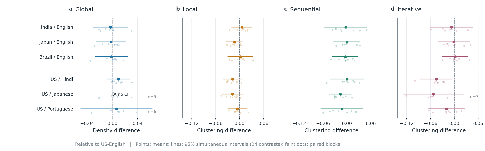
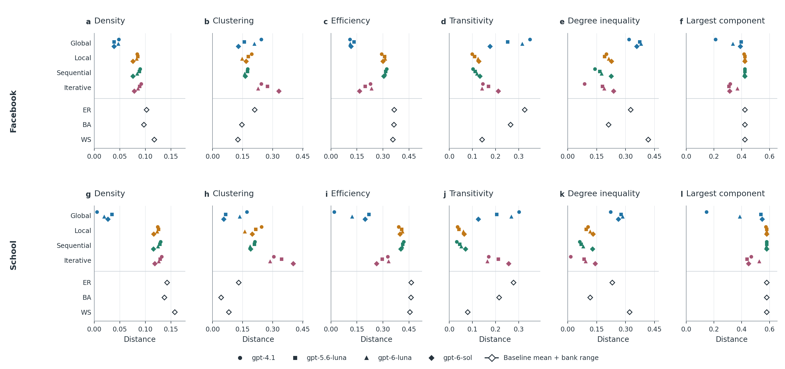
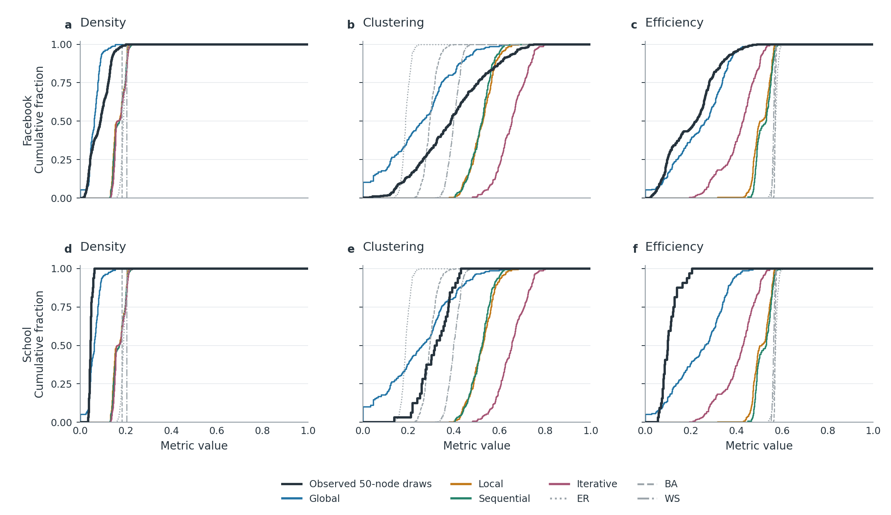

# Analysis And Current Figures

Revision 2 replaces the displays in the main notebooks, not just an optional
gallery. All results use the original **896 attempts / 890 valid graphs**;
the six selectively completed supplements remain separate. No new paid calls.

| Notebook | Contents |
| --- | --- |
| [01: Primary statistics](01_primary_statistical_analysis.ipynb) | Independent statistical checks, all 24 contrasts, robustness and legacy context. |
| [02: Primary comparisons](02_primary_comparison_plots.ipynb) | Seven revised figures: contrasts, model profiles, failures, resources and references. |
| [03: Held-out evaluation](03_heldout_public_evaluation.ipynb) | Independent W1 checks and five revised real-data/baseline figures. |
| [04: Complete figure gallery](04_manuscript_figures.ipynb) | All 12 revised figures with full captions. |

[Full captions and five-paper references](../docs/PUBLICATION_FIGURES_V2.md) |
[PNG/SVG/PDF files](../outputs/publication_figures/20261105_v2/) |
[Reproduction and integrity checks](../ANALYSIS_START_HERE.md) |
[Claude review prompt](../docs/CLAUDE_HELDOUT_AND_FIGURE_REVIEW_PROMPT.md)

## Primary Contrasts

Faint dots are paired schedule blocks, not individual independent people.
Intervals use the original 24-contrast family. One contrast is suppressed for
insufficient complete blocks. Zero does not establish equivalence.

## Real Networks And Classical Baselines

Lower distance means closer on that metric only. The source studies are excluded
from baseline fitting, not necessarily from LLM pretraining. Baseline spans are
simulation ranges, not confidence intervals. No universal winner is established.

## Look Beyond Average Distances

These curves show distributions rather than only distances. The black observed
mixture is descriptive and does not replace cohort-wise scoring. Overlapping
50-node samples are not independent human communities.

## What We Can Say

One primary iterative Hindi-versus-English contrast passes the original Holm
test, but is sensitive to block omission and test assumptions. Classical
baselines are competitive: WS is closer on mean clustering distance for the
Facebook records and BA for the observed school roster than each four-model
LLM method average. Other metrics differ. This is a limited structural test,
not proof of cultural realism, human decision fidelity or publication readiness.

Earlier figure versions remain in their original directories as provenance.
The current displays are hash-verified against the revision-2 manifest.
