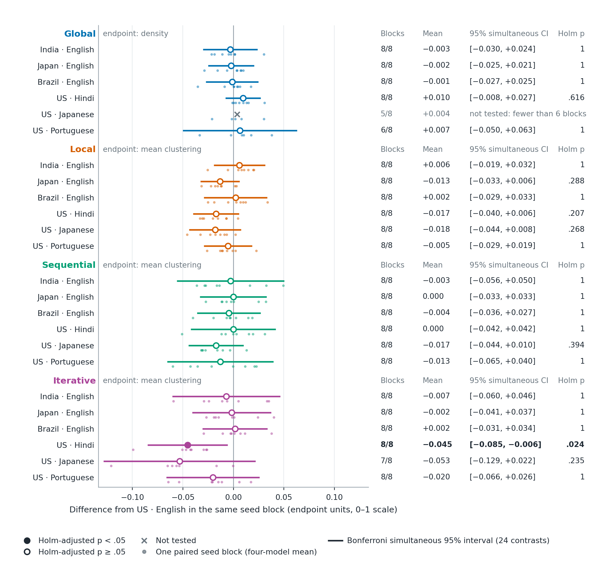
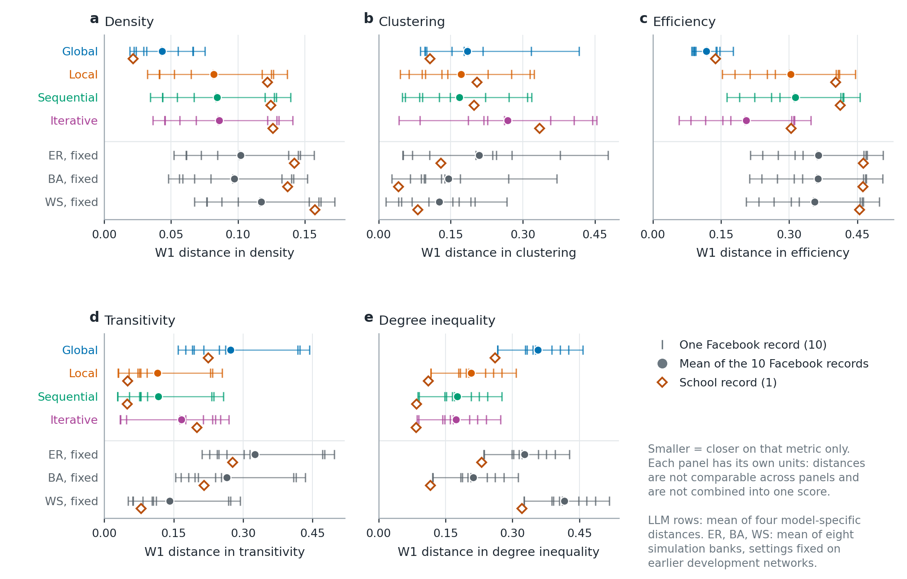
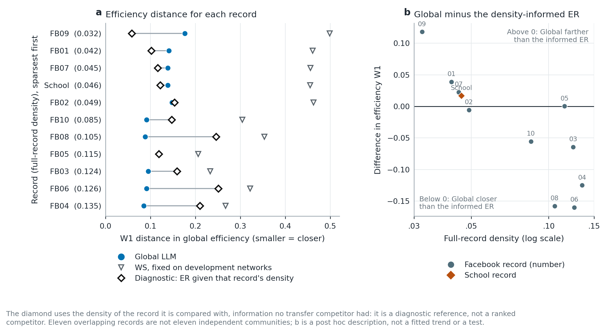
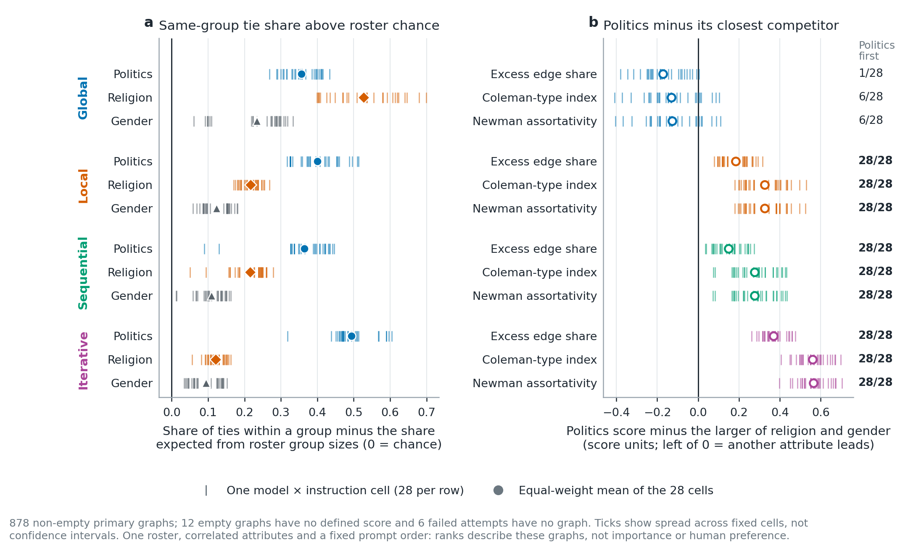

# Analysis And Current Figures

**Reviewed release v6.1, November 15, 2026.** The six notebooks below display all
19 redesigned figures. Figure 16's sign-agreement count and several captions
were corrected after review. Figure 17 now uses vector cells, and SVG glyphs are
outlined for portable fonts; the other 17 PNG/PDF/plotted-CSV sets retain exact v6 bytes.
[Corrections and verification](../docs/figure_redesign/CODEX_REVIEW.md).

Primary analysis uses **896 original attempts: 890 valid graphs, including 12
empty, and six failures**. The six selectively completed supplemental graphs
remain outside all inference and empirical evaluations.

| Notebook | Contents |
| --- | --- |
| [00: Data readiness](00_data_readiness.ipynb) | Cohort separation and integrity; no interpretation |
| [01: Primary statistics](01_primary_statistical_analysis.ipynb) | The locked 24 contrasts, effect sizes, intervals and sensitivity |
| [02: Primary comparisons](02_primary_comparison_plots.ipynb) | Figures 01-07: contrasts, models, failures, resources and references |
| [03: Held-out evaluation](03_heldout_public_evaluation.ipynb) | Seven figures, W1 checks, size sensitivity and density diagnostic |
| [04: Complete gallery](04_manuscript_figures.ipynb) | All 19 current figures and their captions |
| [05: RQ2 demographic mixing](05_rq2_demographic_mixing.ipynb) | Marginal mixing, scoring conventions and fixed-roster limitations |
| [06: RQ2, sampling and Copenhagen](06_rq2_sampling_copenhagen.ipynb) | Paired mixing, ratio matrices, overlapping sampling and structural transfer |

## Figures To Start With



The iterative Hindi contrast passes the original correction but is sensitive to
block omission: only 3/8 refits remain significant. Eight blocks are not eight
human populations. The sign-flip test's attainable p-value floor cannot cross
the first Holm threshold here; it is not another failure of the effect.



Lower W1 means closer on that metric, not more realistic overall. Record ticks
are heterogeneous, overlapping observations, not independent confidence limits.
Read efficiency alongside the density-informed diagnostic below.



Target-density ER narrows the fixed-baseline gap. It uses target information,
so it is a diagnostic, not a fair transfer competitor or causal decomposition.



Politics leads consistently for the person-level procedures, but Global depends
on scoring. One roster, correlated attributes and fixed prompt order prevent an
independent attribute-importance claim.

## Reproduce

From the repository root, using the frozen Python 3.11.9 environment/kernel:

```powershell
rtk proxy .\.venv\Scripts\python.exe -I -B scripts\check_figure_release_v6.py
rtk proxy .\.venv\Scripts\python.exe -I -B scripts\check_research_extension.py
```

[PNG/SVG/PDF and plotted CSVs](../outputs/publication_figures/20261115_v6_1/) |
[Environment and data guide](../ANALYSIS_START_HERE.md) |
[Professor's brief](../docs/PROFESSOR_RESEARCH_BRIEF.md) |
[Historical versions](../docs/history/README.md).

These checks execute six notebooks from published tables, verify 41 embedded
images/captions and historical seals, and make no provider calls or ledger queries.
