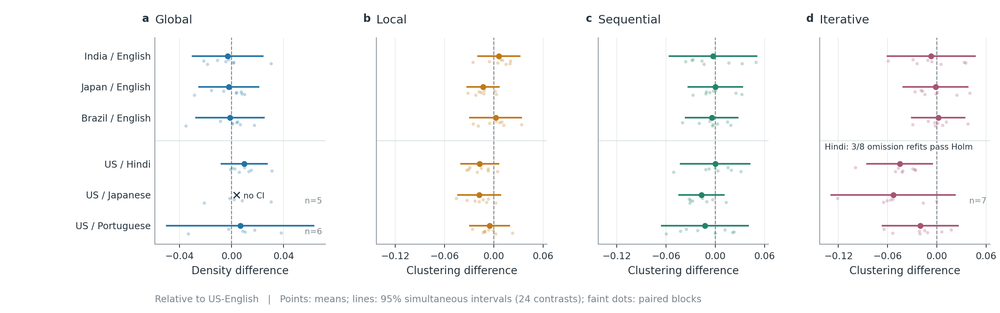
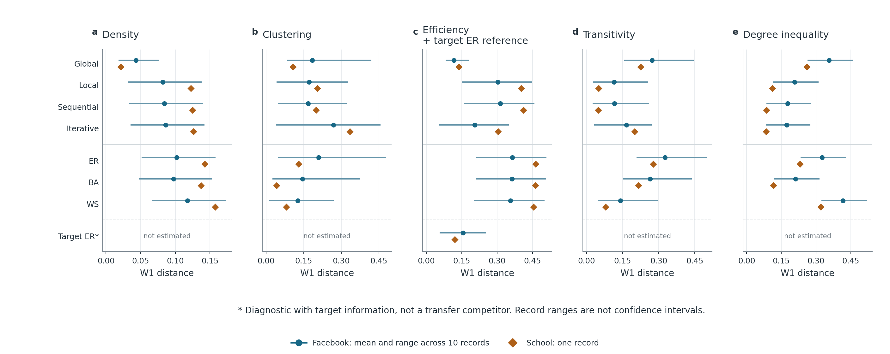
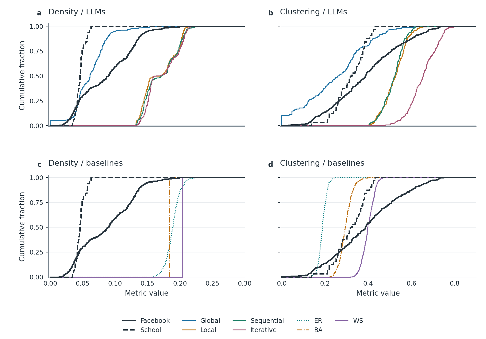

# Analysis And Current Figures

Revision 5 replaces the displays in the main notebooks, not just an optional
gallery. All results use the original **896 attempts / 890 valid graphs**;
the six selectively completed supplements remain separate. No new paid calls.

| Notebook | Contents |
| --- | --- |
| [01: Primary statistics](01_primary_statistical_analysis.ipynb) | Independent statistical checks, all 24 contrasts, robustness and legacy context. |
| [02: Primary comparisons](02_primary_comparison_plots.ipynb) | Seven revised figures: contrasts, model profiles, failures, resources and references. |
| [03: Held-out evaluation](03_heldout_public_evaluation.ipynb) | Independent W1 checks, matched-size sensitivity, seven figures including the density diagnostic and LCC appendix. |
| [04: Complete figure gallery](04_manuscript_figures.ipynb) | 15 figures, including RQ2 score sensitivity and target-density efficiency. |
| [05: RQ2 demographic mixing](05_rq2_demographic_mixing.ipynb) | Primary-only categorical Coleman scores, equal-weight method summaries and all 112 combination rankings. |

[Review findings, scope and figure selection](../docs/DEEP_REVIEW_RESPONSE.md) |
[PNG/SVG/PDF files and sensitivity tables](../outputs/publication_figures/20261112_v5/) |
[Reproduction and integrity checks](../ANALYSIS_START_HERE.md) |
[Claude review prompt](../docs/CLAUDE_HELDOUT_AND_FIGURE_REVIEW_PROMPT.md)

## Primary Contrasts

[Figure 14: political orientation, religion and gender](../outputs/publication_figures/20261112_v5/14_demographic_mixing.png) is a descriptive companion to the planned tests below; it does not extend their 24-test family.

Faint dots are paired schedule blocks, not individual independent people.
Intervals use the original 24-contrast family. One contrast is suppressed for
insufficient complete blocks. Zero does not establish equivalence.

## Real Networks And Classical Baselines

Lower distance means closer on that metric only. The source studies are excluded
from baseline fitting, not necessarily from LLM pretraining. Spans show variation
across the ten Facebook records, not confidence intervals. No universal winner is established.

## Look Beyond Average Distances

These curves show distributions rather than only distances. The black curves
represent Facebook and school separately and do not replace cohort-wise scoring. Overlapping
50-node samples are not independent human communities.

## What We Can Say

One primary iterative Hindi-versus-English contrast passes the original Holm
test, but is sensitive to block omission and test assumptions. Classical
baselines are competitive: WS is closer on mean clustering distance for the
Facebook records and BA for the observed school roster than each four-model
LLM method average at 50 nodes. At 25 nodes BA is closest on Facebook clustering
and ER on school clustering. Other metrics differ. This is a limited structural test,
not proof of cultural realism, human decision fidelity or publication readiness.

Earlier figure versions remain in their original directories as provenance.
[Figure 15](../outputs/publication_figures/20261112_v5/15_efficiency_density.png): matching target density closes 86% of the mean fixed-WS-to-Global efficiency gap, but the source-level results differ. Run `scripts/check_deep_review.py` to verify the embedded figures and their captions.
