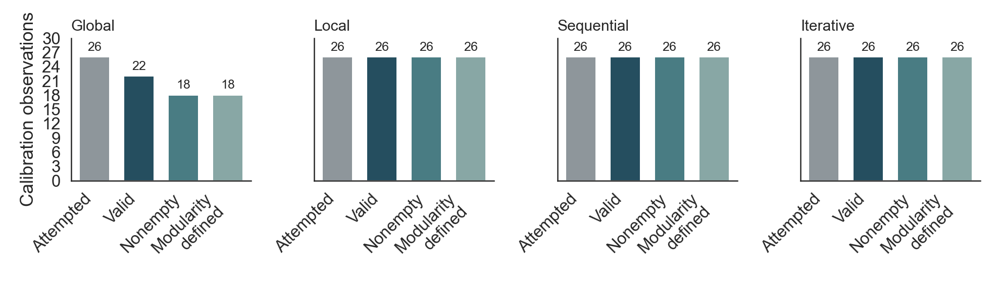

# Before The Final Collection

October 17, 2026. **Offline repair and review package; no paid main study.**
This is the current response to [Raghav's submitted review](PR_REVIEW_OCT17.md).
The older V6/V8 reports remain historical records, not competing active plans.
The [final verification record](PRECOLLECTION_VERIFICATION.md) reports 210 passing
offline tests, replay evidence, review fixes and checks that were not performed.

## What Was Wrong, In Plain Language

The calibration graphs were not fabricated or all broken. The larger problem
was what we could safely conclude from them. Four models using the same two
random schedules do not give eight independent repetitions. A language label
also changes the exact wording, so one translation per language cannot establish
a general language effect. Finally, an invalid response, a valid empty network,
and a network with an undefined statistic are three different outcomes.

Raghav's review correctly made those distinctions urgent. We did not adopt every
suggested conclusion: batch differences do not isolate provider drift from
schedule effects, and treating four selected models or three hand-written
wordings as random effects does not make them representative samples.

## Changes In This Commit

- [x] Add a canonical, **offline-only** audit: `precollection_audit.py`. It checks
  independent source/artifact pins before importing the old recovery code,
  replays a temporary copy and never writes into the calibration directory.
  Private journals, approvals and snapshots are not copied or interpreted as
  extra public observations. Public orphan receipts still fail verification.
- [x] Invalidate its previous clearance before checking dependencies. A corrupt
  source, orphan receipt or failed verification cannot leave a new successful
  report. The older recovery adapter is preserved for historical replay, not
  recommended as the current inspection entry point.
- [x] Report attempted, valid, nonempty and endpoint-defined counts, by method
  and by condition. Do not silently exclude empty or failed observations.
- [x] Implement one candidate analysis specification, paired by schedule, with
  the same four-model panel in both arms and a fixed 24-hypothesis primary family.
- [x] Test known effects, shared schedules, model heterogeneity, a bimodal null,
  informative failures, changed identities, missing partners and zero variance.
- [x] Add an isolated global-parser candidate. It collapses only identical
  undirected pairs, retains raw text and compliance counts, and rejects the whole
  reply if any line has an invalid ID, self-link or malformed syntax.
- [x] Add an isolated Hindi global-instruction candidate: replace the weak
  "possible configuration" phrase with wording meaning realistic/plausible.
  Other languages and operations are unchanged. This is **not** the unsuccessful
  earlier Hindi local-format probe, and it has not been adopted or live-tested.
- [x] Keep the old costs, artifacts, failures and prompts unchanged. No graph
  was repurchased, and no old failure was relabelled successful.
- [ ] Adopt a final prompt/parser contract after reviewing these candidates.
- [ ] Run a small separately authorized live check of any adopted Hindi change.
- [ ] Approve the exact final execution manifest, allocation and current prices.
- [ ] Generate fresh confirmation observations and final RQ results.

## What The Saved Evidence Supports

The key-free audit replays all **104 observations**: **100 valid graphs and four
retained invalid global observations**. All 100 valid graphs have 50 personas;
their saved adjacency and PNG hashes remain checked by the frozen verifier.
There are **11,634 received responses**. All **327 files** in the pinned public
calibration directory remain unchanged before and after the new audit.

| Method | Attempted | Valid | Nonempty | Density defined | Modularity defined |
| --- | ---: | ---: | ---: | ---: | ---: |
| Global | 26 | 22 | 18 | 22 | 18 |
| Local | 26 | 26 | 26 | 26 | 26 |
| Sequential | 26 | 26 | 26 | 26 | 26 |
| Iterative | 26 | 26 | 26 | 26 | 26 |



The parser candidate can interpret the three duplicate-pair failures without a
new model call. The fourth reply contains an invalid ID and remains invalid.
Those are **offline parser diagnostics**, not three newly successful V8 graphs.
All 22 previously valid global graphs must retain exactly the same edges under
the candidate; the audit fails if any changes. Existing empty graphs stay empty.

Graph replay and PNG integrity are different from visual quality or scientific
validity. The new count figure is derived from the saved observations. No
historical network PNG has been cosmetically replaced in this repair.

## Candidate Analysis, Not A Spending Approval

The machine-readable authority for this candidate is
[`precollection_spec.json`](../precollection_spec.json), not old forecast tables.

**Scope:** four fixed model configurations (`gpt-4.1`, `gpt-5.6-luna`,
`gpt-6-luna`, `gpt-6-sol`), all four methods, the same 50 fictional adults.
Seven settings: US/India/Japan/Brazil in English, and US in Hindi, Japanese and
Brazilian Portuguese. English is shared, not duplicated. This is not a full
four-country by four-language factorial. Persona data fields stay English.

**Narrowed claim:** sensitivity to these seven named instruction contracts.
RQ1 concerns country framing, not national populations. RQ4 concerns the exact
instruction versions, not language effects independent of translation choices.
If the team requires the broader RQ4 claim, it needs a separately designed
multi-wording study; adding repetitions alone does not solve that problem.

**Primary outcomes:** global density; local, sequential and iterative mean local
clustering. Both are bounded in [0, 1]. Degree-under-two nodes contribute zero
clustering, so a valid empty graph has a defined primary value of zero. Density
in the quota methods is descriptive because the requested choices constrain it.
Categorical homophily, numeric age assortativity, modularity, per-model patterns
and matched controls remain secondary/descriptive. Religion is not selected as a
primary just because its calibration signal looked strongest.

**Comparisons:** average the four models equally within each schedule and
condition; subtract US-English within the same schedule. Three country plus
three instruction contrasts, across four methods, give **24 primary tests**.
Holm adjusts that entire family. Schedule blocks, not individual model rows,
are the uncertainty units. Per-model differences remain visible beside the mean.

**Failures:** every planned cell needs a result or explicit failure. A missing
model never creates a new three-model panel. Report complete-block means and
[0, 1]-bounded missing-data extremes. If any planned block is incomplete,
primary inferential output is suppressed for that contrast; its place in the
24-test family is retained. Undefined secondary metrics are not zero-filled.
Zero-variance differences do not receive a spurious significance claim.

**Precision:** the candidate lays out 32 fresh schedules, 44,000 through 44,031,
giving **3,584 attempts**. This is a planning recommendation, not an automatic
replacement of the earlier authorization. The 0.03 half-width scenario is a
planning tolerance, not a scientifically justified meaningful-effect threshold.
The SD/interval table is assumption-based; two calibration schedules cannot
establish full-panel power. A nonsignificant result is not proof of equivalence.
The t diagnostics assume independent blocks and adequate distributional
approximation; tests of synthetic fixtures do not prove those assumptions.

## Cost And Runtime

These forecasts scale **historical V8 usage/rates**, not a live price quote.
They include the observed frequency of received invalid replies, but cannot
predict future outage rates or provider changes. Country transfer is partly
extrapolated. Calibration is not reused in confirmation.

| Fresh schedules | Attempts | Usage estimate | With 25% allowance | Serial API hours | With 50% time allowance |
| --- | ---: | ---: | ---: | ---: | ---: |
| 8 | 896 | $102.44 | $128.05 | 26.30 | 39.46 |
| 16 | 1,792 | $204.89 | $256.11 | 52.61 | 78.91 |
| 32 | 3,584 | $409.77 | $512.21 | 105.22 | 157.82 |

The earlier ~$104.49 estimate meant **32 global repetitions but only eight for
the other methods**, not 32 across all methods. API hours exclude pauses and
review time. The final changed-contract estimate must be refreshed before launch.
This commit spent **$0 on model generation**.

## What Still Needs Regeneration

**Not the historical calibration.** Its original graph, prompt and failure
records remain useful evidence. Re-running a verifier or computing a new table
does not require another paid response.

Only adopted prompt changes need fresh behavior checks. A reasonable next
candidate is eight Hindi-global observations (four models, two matched fresh
schedules) under the final Hindi contract. Duplicate canonicalization itself
can be checked offline against raw replies. If both policies are adopted, new
confirmation cells use a new contract; they never overwrite V8 records. No
eight-graph or main-run authorization is created by this proposal.

The current safe transport policy remains SDK retries zero, received-response
reuse, and stop on unresolved billing with its reservation retained. The two
historical one-off replacements do not authorize unlimited retries. A generic
automatic retry runner is **not implemented or approved here**. Before unattended
main collection, either explicitly accept the stop/review policy or implement
and test a bounded recovery policy against the final runner and private ledger.

Use a fresh environment-based credential before paid work. Do not paste it into
chat or commit it. No rotation or provider invoice reconciliation is claimed.

## Reproduce Offline

Use the existing pinned Python 3.11 environment; no new statistical dependency
or API key is required. These commands run from the repository root:

```powershell
python -X utf8 -B -m unittest tests.test_precollection -q
python -X utf8 -B precollection_audit.py
python -X utf8 -B -m unittest discover -s tests -q
```

Use `precollection_audit.verified_report()` (also used by the notebook). It checks
the separate attempt state, report hash, source pins and output hashes together.
A failed/pending audit means the tables must not be treated as freshly verified.
If the filesystem prevents every invalidation write, the failed command remains
authoritative: never treat an older report as that command's success. Source edits require
explicit review and a new pin manifest, never an automatic accept-current-hashes
command. A manifest is accidental-change protection, not a defense against an
actor who can alter both code and pins.

The supplied review's optional `statsmodels` ANOVA appendix is not part of the
generation lock or this reproduction. We do not claim to have reproduced or
accepted its unblocked ANOVA as the confirmatory method. The new analysis uses
the already pinned NumPy/SciPy stack and paired schedule-level differences.

## Note For The Professor And Team

We preserved the calibration and checked that the saved responses still produce
the same graphs. The latest work fixes how we count usable results, makes the
proposed comparisons explicit, and prevents the audit from showing an old pass
after a new failure. We also isolated the Hindi and duplicate-pair fixes so they
cannot quietly change the evidence you already reviewed.

Please review the narrowed claims and the candidate analysis before the final
collection contract is approved. This package is ready for that review, not a
certificate of error-free research or conference acceptance. No main study is
running, and the simulation has intentionally not changed in this repair.
