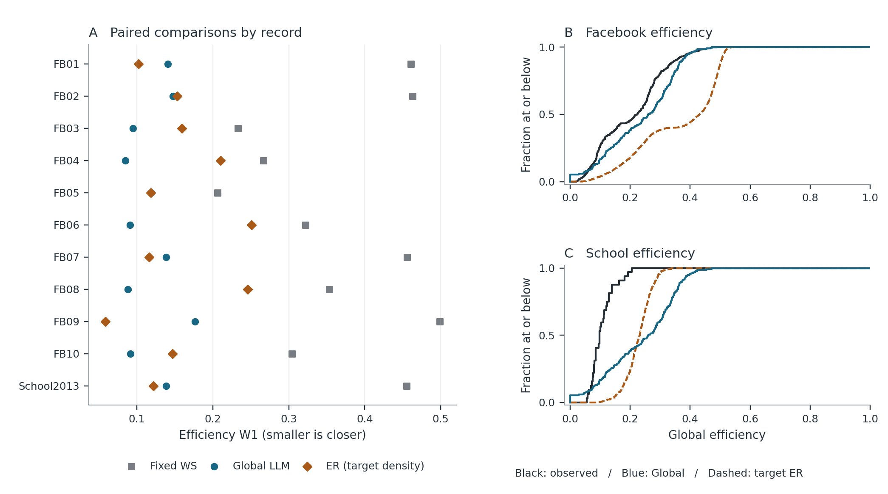
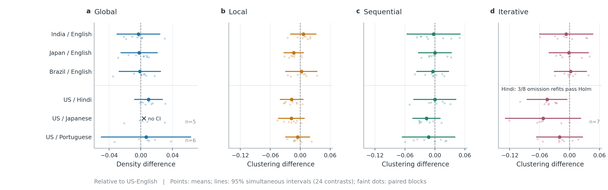

# What the network study can claim

**November 11, 2026.** How much does an AI-generated friendship network tell us beyond a simple random graph? Our clearest finding is that a seemingly large advantage on reachability gets much smaller once the random graph has the same chance of a tie as the observed network. That is a useful check on what counts as evidence of social realism.

## The comparison to show first

At 50 nodes we compared the distribution of global efficiency (short paths, counting disconnected pairs as zero). W1 is a distance: smaller means a closer match **on this property alone**. Global asks an LLM to generate the whole network at once. WS is a small-world baseline calibrated on development data. As a separate diagnostic we gave a random-edge generator (ER) the full density of each target record. It has information neither transfer competitor was fitted on.

| Mean efficiency W1 | Global LLM | Fixed WS | ER given target density |
| --- | ---: | ---: | ---: |
| Facebook, ten records weighted equally | 0.117 | 0.356 | 0.156 |
| School, one survey | 0.138 | 0.455 | 0.121 |
| All 11 records weighted equally | 0.119 | 0.365 | 0.153 |

The random reference closes **86% of the fixed-WS-to-Global gap**. It is strictly closer than Global on five records and within 0.015 behind on one more. That cutoff is descriptive, not an equivalence margin. This does **not** mean density causes 86% of real friendship behavior. The school result reverses the ordering seen in the Facebook mean; eleven records are not eleven independent communities.

**Clustering is a different question:** do friends of a person also tend to be friends with one another? At 50 nodes, WS had the smallest mean distance on Facebook (0.1259); BA, a preferential-attachment model, did at school (0.0416). At 40 nodes on Facebook the top two are only 0.0037 apart; at 25 nodes at school ER and Global differ by 0.0171. The ordering changes with size. Classical models are competitive; there is no stable overall winner. Positive mean observed-minus-degree-swap clustering in all 11 records is descriptive evidence of closure not reproduced by these controls, not a significance test.

[Five-metric comparison](../outputs/publication_figures/20261111_v4/08_heldout_distances.png) | [Rank margins](../outputs/publication_figures/20261111_v4/clustering_margins.csv) | [Record distances](../outputs/publication_figures/20261111_v4/efficiency_records.csv)

## The planned statistical result

With iterative generation, the estimated difference in average clustering was **-0.0453 on a 0-1 scale** (US-Hindi minus US-English; 95% familywise interval **[-0.0850, -0.0056]**, Holm-adjusted **p = 0.0238**). This is an absolute difference, not a 4.53% relative decrease. Of 24 planned contrasts, 23 were testable and only this one passed the original correction. All eight paired seed blocks had the same direction, but only **3 of 8** leave-one-block-out fits retained significance. An exploratory sign-flip test gave adjusted p = 0.1875. Report the direction and the fragility together; the other comparisons do not establish equivalence.

[All effects and intervals](../outputs/primary_analysis/20261105/primary_contrasts.csv) | [Leave-one-block-out results](../outputs/publication_figures/20261105_v3/02_primary_robustness.png)

## RQ2: Which demographic similarities show up in ties?

[Figure 14](../outputs/publication_figures/20261111_v4/14_demographic_mixing.png) shows all 28 model/instruction combinations per method. In all three person-level methods, political orientation ranks first in 28/28 on both measures. Under Global it ranks first in 6/28 with Coleman and only 1/28 by excess same-group edge share; religion leads in the other combinations. Neither is a measure of independent importance. All 878 scored graphs use one roster with different category sizes; religion and politics co-vary (descriptive Cramer's V = 0.316). Prompt field order was fixed. Separating these explanations would require new counterbalanced prompts and rosters. [Executed RQ2 notebook](../analysis/05_rq2_demographic_mixing.ipynb).

## What failed, and why it matters

Of **896 planned attempts**, **890 produced valid graphs**, including 12 with no edges. The six failures were not evenly distributed. Each row below represents 32 planned attempts (four models by eight seeds); a comparison block is complete only when the required model pairs are present.

| Affected primary condition | Recorded failure | Consequence for the planned comparison |
| --- | --- | --- |
| Global, US-Japanese | 3/32 invalid whole-network responses | 5/8 complete blocks; below the six-block minimum, so no test or interval |
| Global, US-Portuguese | 2/32 invalid whole-network responses | 6/8 complete blocks; effect estimated on those six |
| Iterative, US-Japanese | 1/32 exhausted its allowed corrections | 7/8 complete blocks; effect estimated on those seven |

These are recorded failure modes, not evidence that a language caused a failure. The held-out comparison describes graphs the methods successfully produced. We retain the failures rather than setting their metrics to zero or substituting the six later successes. Those supplements were selected after failure and are excluded from both evaluations.

[Coverage and missingness plot](../outputs/publication_figures/20261105_v3/04_coverage_missingness.png) | [Failure records, filter to primary](../outputs/analysis_ready/060dcd3a86d5/failures.csv) | [Per-cell denominators](../outputs/primary_analysis/20261105/coverage_by_cell.csv)

## Contribution and limits

- **What builds on prior work:** Chang et al. already compared LLM friendship graphs with empirical networks and classical generators. Neither that comparison nor the use of ER, BA and WS is our novelty. Our extension separates a locked instruction comparison from a transfer benchmark: we keep the baseline settings fixed on new sources, show how the answer changes by metric and observation size, and expose which conclusions survive missing attempts. This is a contribution relative to the [five reviewed papers](PRIMARY_LITERATURE_REVIEW.md), not a claim of being first in the field.
- **What the design cannot establish:** one fictional roster, four fixed models, eight paired blocks and unequal computation across procedures. The language result concerns these prompts, not Hindi speakers or national culture. Held out means not used to fit the baselines, not necessarily unseen in model training.
- **Where external evidence stops:** ten Facebook records overlap; the Marseille school is one incomplete survey. Repeated node samples are not independent communities. Matching a structural statistic does not mean predicting real friendships. The next informative test would freeze the evaluation on additional independent communities and multiple rosters, with a comparable compute budget. That test has not been run.

**Decision for the meeting:** Does the density and size sensitivity warrant the paper's headline, with the instruction effect as a qualified secondary finding? Ask the reviewer to argue against that framing using the [Claude review instructions](CLAUDE_HELDOUT_AND_FIGURE_REVIEW_PROMPT.md).
