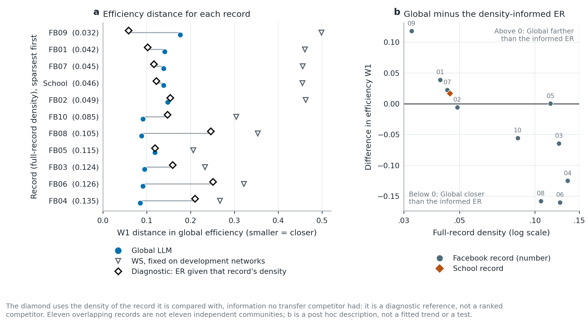
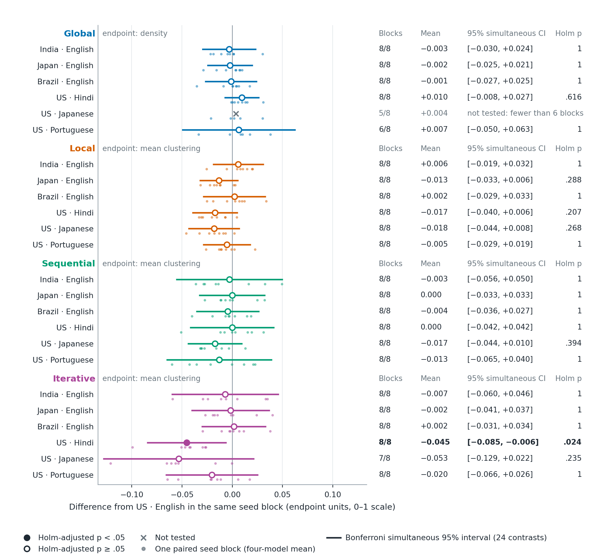

# What the network study can claim

**November 14 addendum:** [executed RQ2, sampling and Copenhagen extension](research/EXTENSION_RESULTS_20261114.md)
and [notebook 06](../analysis/06_rq2_sampling_copenhagen.ipynb). Political orientation
remains first in all 28 combinations for each person-level method across three
scores and each seed omission. The new Copenhagen comparison is explicitly
endpoint-conditioned: its mean clustering falls from 0.315 in the full record
to 0.080 in 50-node samples. Fixed ER is closer on sampled clustering than Global;
Global is closer on several other metrics. Giving ER target density changes
the efficiency comparison but does not reproduce transitivity. These are
exploratory findings, not additional corrected tests or human-behavior validation.
The older results below retain their original 11-record scope.

**Reviewed figure release v6.2 (November 18, 2026).** Notebooks 01-06 display all 19 redesigned figures, with raw and adjusted Hindi refits and the Copenhagen sampling stress test. Primary estimates and tests are unchanged; all earlier sealed artifacts remain intact. See [review corrections](figure_redesign/CODEX_REVIEW.md). Current checker: `scripts/check_figure_release_v6.py`.

**November 12, 2026.** How much does an AI-generated friendship network tell us beyond a simple random graph? Our clearest finding is that a seemingly large advantage on reachability gets much smaller once the random graph has the same chance of a tie as the observed network. That is a useful check on what counts as evidence of social realism.

## The comparison to show first

At 50 nodes we compared the distribution of global efficiency (short paths, counting disconnected pairs as zero). W1 is a distance: smaller means a closer match **on this property alone**. Global asks an LLM to generate the whole network at once. WS is a small-world baseline calibrated on development data. As a separate diagnostic we gave a random-edge generator (ER) the full density of each target record. It has information neither transfer competitor was fitted on.

| Mean efficiency W1 | Global LLM | Fixed WS | ER given target density |
| --- | ---: | ---: | ---: |
| Facebook, ten records weighted equally | 0.117 | 0.356 | 0.156 |
| School, one survey | 0.138 | 0.455 | 0.121 |
| All 11 records weighted equally | 0.119 | 0.365 | 0.153 |

**The pooled result hides density sensitivity.** Using the review's post-hoc split, not a preregistered threshold:

| Full-record density | Records | Global mean W1 | Target ER mean W1 |
| --- | ---: | ---: | ---: |
| Below 0.06 | 4 Facebook + school | 0.1484 | 0.1103 |
| At least 0.06 | 6 Facebook | 0.0949 | 0.1886 |

ER is strictly closer on four of the five sparse records. The exception (FB02) favors Global by 0.0056. Global is strictly closer on five of six denser records; FB05 favors ER by 0.0003. These near matches are **not exact ties**. A 0.015 tolerance is descriptive, not a tested equivalence bound. Density alone is not sufficient to reproduce every record; neither band is an independent population sample.

The random reference closes **86% of the fixed-WS-to-Global gap**. It is strictly closer than Global on five records and within 0.015 behind on one more. That cutoff is descriptive, not an equivalence margin. This ratio can exceed 100%: it is 105% on the school record because ER is closer there than Global. It is not a bounded quality score. This does **not** mean density causes 86% of real friendship behavior. The school result reverses the ordering seen in the Facebook mean; eleven records are not eleven independent communities.

**Clustering is a different question:** do friends of a person also tend to be friends with one another? At 50 nodes, WS had the smallest mean distance on Facebook (0.1259); BA, a preferential-attachment model, did at school (0.0416). At 40 nodes on Facebook the top two are only 0.0037 apart; at 25 nodes at school ER and Global differ by 0.0171. The ordering changes with size. Classical models are competitive; there is no stable overall winner. Positive mean observed-minus-degree-swap clustering in all 11 records is descriptive evidence of closure not reproduced by these controls, not a significance test.

[Five-metric comparison](../outputs/publication_figures/20261118_v6_2/08_heldout_distances.png) | [Rank margins](../outputs/publication_figures/20261111_v4/clustering_margins.csv) | [Record distances](../outputs/publication_figures/20261111_v4/efficiency_records.csv)

## The planned statistical result

With iterative generation, average clustering was **0.0453 lower on a 0-1 scale** for US-Hindi than US-English (95% familywise interval for the difference **[-0.0850, -0.0056]**; paired t-test raw **p = 0.000993**, Holm **p = 0.0238**). Of 24 planned contrasts, 23 were testable and only this one passed correction. **The direction was stable; crossing the corrected threshold was not.** All eight block differences were negative. Omitting any one block gave a mean between -0.0480 and -0.0376 and raw p no larger than 0.00358; only 3/8 refits passed Holm. With eight blocks the t-test's distributional assumption matters: a post hoc Shapiro-Wilk check on the eight differences gave p = 0.0126, a reason for caution rather than a replacement hypothesis test. The exact two-sided sign-flip p reached its floor (2/256); even this minimum cannot clear the first Holm cutoff of 0.05/24. That test cannot independently confirm the familywise result, but it does not show a reversal. This is a prompt contrast on one roster, not a statement about Hindi speakers.

**Reading the external figures:** Figure 19 is a sampling stress test. Across 32 uniform 50-node Copenhagen draws, mean density was 0.0202 (about 25 of 1,225 possible edges), 47.4% of nodes were isolated, and mean clustering fell from 0.315 on the full endpoint roster to 0.080. A small distance here is agreement with the sampled target, not validation against an intact community. A connected-sampling comparison would answer a different question and should be shown alongside, not instead of, uniform sampling. Figure 12 also shows that Global's clustering distance differs across Facebook records: 0.096 at FB09 (density 0.032) versus 0.417 at FB06 (0.126). These overlapping records are descriptive examples, not independent evidence that density causes the difference.

[All effects and intervals](../outputs/primary_analysis/20261105/primary_contrasts.csv) | [Leave-one-block-out results](../outputs/publication_figures/20261118_v6_2/02_primary_robustness.png)

## RQ2: Which demographic similarities show up in ties?

[Figure 14](../outputs/publication_figures/20261118_v6_2/14_demographic_mixing.png) shows all 28 model/instruction combinations per method. In all three person-level methods, political orientation ranks first in 28/28 on all three displayed scores. Under Global it ranks first in 6/28 with the Coleman-type index and Newman and only 1/28 by excess same-group edge share; religion leads in the other combinations. Neither is a measure of independent importance. All 878 scored graphs use one roster with different category sizes; religion and politics co-vary (descriptive Cramer's V = 0.316). Prompt field order was fixed. Separating these explanations would require new counterbalanced prompts and rosters. [Executed RQ2 notebook](../analysis/05_rq2_demographic_mixing.ipynb).

## What failed, and why it matters

Of **896 planned attempts**, **890 produced valid graphs**, including 12 with no edges. The six failures were not evenly distributed. Each row below represents 32 planned attempts (four models by eight seeds); a comparison block is complete only when the required model pairs are present.

| Affected primary condition | Recorded failure | Consequence for the planned comparison |
| --- | --- | --- |
| Global, US-Japanese | 3/32 invalid whole-network responses | 5/8 complete blocks; below the six-block minimum, so no test or interval |
| Global, US-Portuguese | 2/32 invalid whole-network responses | 6/8 complete blocks; effect estimated on those six |
| Iterative, US-Japanese | 1/32 exhausted its allowed corrections | 7/8 complete blocks; effect estimated on those seven |

These are recorded failure modes, not evidence that a language caused a failure. The held-out comparison describes graphs the methods successfully produced. We retain the failures rather than setting their metrics to zero or substituting the six later successes. Those supplements were selected after failure and are excluded from both evaluations.

[Coverage and missingness plot](../outputs/publication_figures/20261118_v6_2/04_coverage_missingness.png) | [Failure records, filter to primary](../outputs/analysis_ready/060dcd3a86d5/failures.csv) | [Per-cell denominators](../outputs/primary_analysis/20261105/coverage_by_cell.csv)

## Contribution and limits

- **What builds on prior work:** Chang et al. already compared LLM friendship graphs with empirical networks and classical generators. Neither that comparison nor the use of ER, BA and WS is our novelty. Our extension separates a locked instruction comparison from a transfer benchmark: we keep the baseline settings fixed on new sources, show how the answer changes by metric and observation size, and expose which conclusions survive missing attempts. This is a contribution relative to the [five reviewed papers](PRIMARY_LITERATURE_REVIEW.md), not a claim of being first in the field.
- **What the design cannot establish:** one fictional roster, four fixed models, eight paired blocks and unequal computation across procedures. The language result concerns these prompts, not Hindi speakers or national culture. Held out means not used to fit the baselines, not necessarily unseen in model training.
- **Where external evidence stops:** ten Facebook records overlap; the Marseille school is one incomplete survey. The November 14 extension adds one Copenhagen endpoint-conditioned record, not a complete observation roster. Repeated node samples are not independent communities. Matching a structural statistic does not mean predicting real friendships. Multiple independently constructed fictional rosters and compute-comparable generation remain unrun future work.

**Decision for the meeting:** Does the density and size sensitivity warrant the paper's headline, with the instruction effect as a qualified secondary finding? Ask the reviewer to argue against that framing using the [Claude review instructions](CLAUDE_HELDOUT_AND_FIGURE_REVIEW_PROMPT.md).
