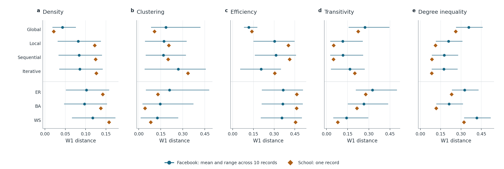

# What the network study can claim

**For the professor and manuscript reviewer | November 6, 2026.** Lead with the real-network comparison, not with the smallest p-value. On the two held-out friendship sources, the best match for how tightly friends cluster was a classical generator. The best match for how easily people can reach each other was an LLM procedure. These are different properties of the same networks.

## The comparison to show first

At 50 people, compare the closest of four LLM procedures with the closest of three classical generators. The numbers are Wasserstein distances (W1): zero means identical distributions **on that metric**; smaller is closer. Each Facebook record gets equal weight; the school is one survey. These are descriptive comparisons, not significance tests.

| Real source | Property | Closest LLM (W1) | Closest classical model (W1) |
| --- | --- | --- | --- |
| Facebook friendship circles | Clustering | Sequential, 0.1678 | Small-world (WS), **0.1259** |
| School friendship survey | Clustering | Global, 0.1067 | Preferential attachment (BA), **0.0416** |
| Facebook friendship circles | Efficiency | Global, **0.1173** | Small-world (WS), 0.3563 |
| School friendship survey | Efficiency | Global, **0.1383** | Small-world (WS), 0.4550 |

**Why size matters:** keep only 25 people from each 50-person graph, on both the generated and observed sides, and the closest clustering baseline changes on *both* sources: WS to BA on Facebook, BA to random edges (ER) at school. Global remains closest on efficiency at 25, 40 and 50. This checks sensitivity to observing fewer people; it does not test models asked to generate smaller networks. Efficiency measures short paths, counting disconnected pairs as zero, not how well people communicate.

[Full scores](../outputs/publication_figures/20261105_v3/sensitivity_source_summary.csv) | [How sampling changes the target](../outputs/publication_figures/20261105_v3/10_sampling_effect.png) | [Distribution shapes](../outputs/publication_figures/20261105_v3/09_heldout_distributions.png)

## The planned statistical result

With iterative generation, the estimated difference in average clustering was **-0.0453 on a 0-1 scale** (US-Hindi minus US-English; 95% familywise interval **[-0.0850, -0.0056]**, Holm-adjusted **p = 0.0238**). This is an absolute difference, not a 4.53% relative decrease. Of 24 planned contrasts, 23 were testable and only this one passed the original correction. All eight paired seed blocks had the same direction, but only **3 of 8** leave-one-block-out fits retained significance. An exploratory sign-flip test gave adjusted p = 0.1875. Report the direction and the fragility together; the other comparisons do not establish equivalence.

[All effects and intervals](../outputs/primary_analysis/20261105/primary_contrasts.csv) | [Leave-one-block-out results](../outputs/publication_figures/20261105_v3/02_primary_robustness.png)

## What failed, and why it matters

Of **896 planned attempts**, **890 produced valid graphs**, including 12 with no edges. The six failures were not evenly distributed. Each row below represents 32 planned attempts (four models by eight seeds); a comparison block is complete only when the required model pairs are present.

| Affected primary condition | Recorded failure | Consequence for the planned comparison |
| --- | --- | --- |
| Global, US-Japanese | 3/32 invalid whole-network responses | 5/8 complete blocks; below the six-block minimum, so no test or interval |
| Global, US-Portuguese | 2/32 invalid whole-network responses | 6/8 complete blocks; effect estimated on those six |
| Iterative, US-Japanese | 1/32 exhausted its allowed corrections | 7/8 complete blocks; effect estimated on those seven |

These are recorded failure modes, not evidence that a language caused a failure. The held-out comparison describes graphs the methods successfully produced. We retain the failures rather than setting their metrics to zero or substituting the six later successes. Those supplements were selected after failure and are excluded from both evaluations.

[Coverage and missingness plot](../outputs/publication_figures/20261105_v3/04_coverage_missingness.png) | [Failure records, filter to primary](../outputs/analysis_ready/060dcd3a86d5/failures.csv) | [Per-cell denominators](../outputs/primary_analysis/20261105/coverage_by_cell.csv)

## Contribution and limits

- **What builds on prior work:** Chang et al. already compared LLM friendship graphs with empirical networks and classical generators. Neither that comparison nor the use of ER, BA and WS is our novelty. Our extension separates a locked instruction comparison from a transfer benchmark: we keep the baseline settings fixed on new sources, show how the answer changes by metric and observation size, and expose which conclusions survive missing attempts. This is a contribution relative to the [five reviewed papers](PRIMARY_LITERATURE_REVIEW.md), not a claim of being first in the field.
- **What the design cannot establish:** one fictional roster, four fixed models, eight paired blocks and unequal computation across procedures. The language result concerns these prompts, not Hindi speakers or national culture. Held out means not used to fit the baselines, not necessarily unseen in model training.
- **Where external evidence stops:** ten Facebook records overlap; the Marseille school is one incomplete survey. Repeated node samples are not independent communities. Matching a structural statistic does not mean predicting real friendships. The next informative test would freeze the evaluation on additional independent communities and multiple rosters, with a comparable compute budget. That test has not been run.

**Decision for the meeting:** Does the metric-and-size result warrant the paper's headline, with the instruction effect as a qualified secondary finding? Ask the reviewer to argue against that framing using the [Claude review instructions](CLAUDE_HELDOUT_AND_FIGURE_REVIEW_PROMPT.md).
