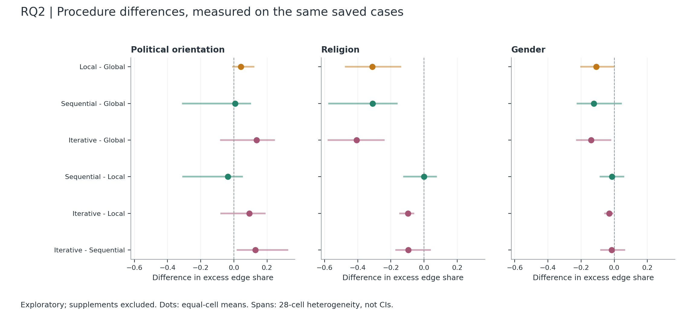
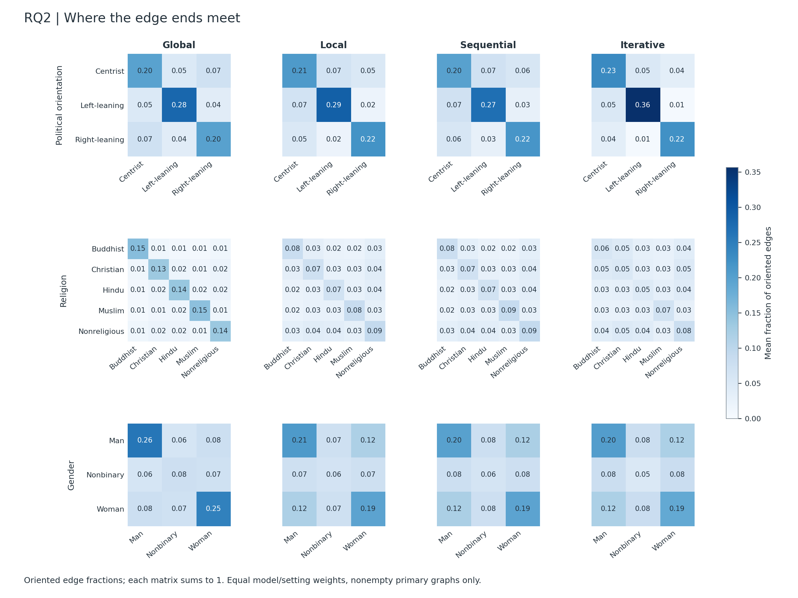
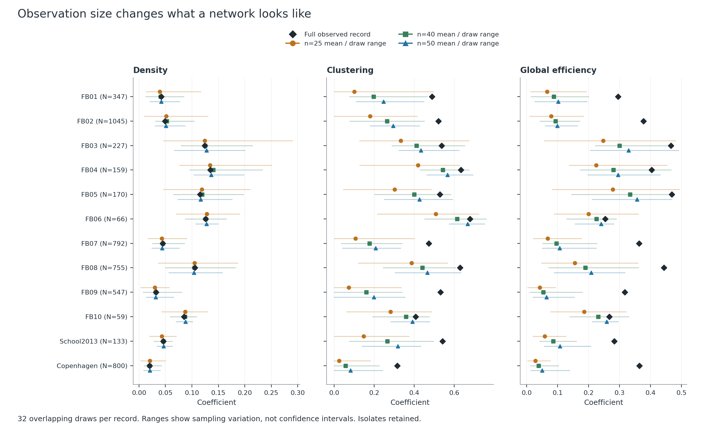
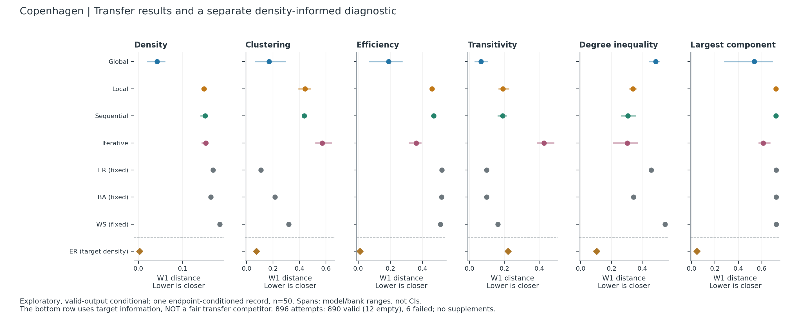

# RQ2 Mixing And Copenhagen: Results With Boundaries

**November 14, 2026. Executed offline, exploratory extension.**
The original 896 attempts remain the analysis population: 890 valid graphs,
including 12 empty graphs, and six failures. **All six supplements are excluded.**
No provider calls, live-ledger queries or changes to the locked 24 primary tests.

[Executed notebook 06](../../analysis/06_rq2_sampling_copenhagen.ipynb) |
[All CSV/PNG/SVG/PDF outputs](../../outputs/research_extension/20261114_v2/) |
[Execution protocol](../../analysis_extension/protocol.json) |
[Integrity manifest](../../outputs/research_extension/20261114_v2/manifest.json)

## The Professor Version

"I strengthened the demographic analysis by comparing the procedures on the
same cases, rather than only naming the attribute with the highest score. The
person-level procedures still place politics first across the fixed panel,
including an alternative score and seed-removal checks. That is a stable
pattern in our generated data, not proof of real people's preferences.

I also checked a new Copenhagen friendship dataset without refitting the
transfer baselines. It exposes an important limitation: taking 50 people from
a large network removes many connecting paths and triangles. Global matches
some sparse-network properties better than the fixed classical baselines, but
not everything. Giving a random graph Copenhagen's density changes several
comparisons dramatically. The useful finding is where our conclusions hold,
and where observation size or baseline information changes them."

## 1. RQ2: Paired Mixing, Not Independent Attribute Importance



**Point at the religion panel.** Compared with Global, the mean excess
same-religion edge share is lower by 0.3110 for Local, 0.3103 for Sequential,
and 0.4062 for Iterative. All 28 cell means have that direction for these three
contrasts. These are absolute edge-share differences, not accuracy gains.

**Then point at politics.** Iterative minus Sequential is +0.1292 on average
(28 cell means range +0.0225 to +0.3229, 223 defined paired seeds). Other political
method contrasts can change direction across cells. The plot shows heterogeneity,
not confidence intervals or new significance tests.

Pair each method on model, instruction setting and seed **before** averaging.
Average usable paired seeds within a cell, then weight all 28 cells equally.
Global comparisons have 206 or 207 defined pairs because its failures and empty
graphs remain missing; they are not replaced. Missing an entire cell suppresses
the overall estimate. [All pairs and denominators](../../outputs/research_extension/20261114_v2/mixing_method_sensitivity.csv).

### Score And Seed Sensitivity

| Method | Politics first: Coleman | Excess edge share | Newman |
| --- | ---: | ---: | ---: |
| Global | 6/28 | 1/28 | 6/28 |
| Local | 28/28 | 28/28 | 28/28 |
| Sequential | 28/28 | 28/28 | 28/28 |
| Iterative | 28/28 | 28/28 | 28/28 |

These rankings use shared defined seeds across attributes **and scores**.
Omitting each seed globally leaves the person-level methods at 28/28 for every
score. Global varies: Coleman 4-7/28, excess 0-3/28, Newman 4-9/28.
This is descriptive sensitivity in the same fixed panel, not independent
replication or a probability of future success.

All three scores are defined on the same 878 nonempty primary graphs here:
207 Global, 224 Local, 224 Sequential, 223 Iterative. Twelve empty graphs have
undefined mixing scores; six failures have no graph. Both remain in the coverage
tables. Newman compares edge-end shares, while Coleman/excess use roster-based
references. Their agreement does not remove attribute correlation or fixed
prompt-order confounding. [Coverage](../../outputs/research_extension/20261114_v2/mixing_coverage.csv) |
[Rank sensitivity](../../outputs/research_extension/20261114_v2/mixing_rank_sensitivity.csv).



**Point at the religion diagonals across procedures**, not darkness across
different attributes. Each undirected edge contributes in both directions;
each matrix sums to one. Nonempty graphs are averaged within cells, then cells
equally. Category prevalence and edge-end marginals affect the diagonal.
[Matrices and marginals](../../outputs/research_extension/20261114_v2/mixing_matrices.csv).

This extends the earlier [RQ2 notebook](../../analysis/05_rq2_demographic_mixing.ipynb),
without altering it. It does not infer political polarization dynamics, causal
attribute importance or cultural fidelity.

## 2. Sampling: 50 People Do Not Preserve The Whole Network



Black diamonds show full observed records. Colored points and spans show means
and full ranges of 32 overlapping induced draws at 25, 40 and 50 nodes. Smaller
draws are nested; sampling-created isolates stay in every metric. Original IDs,
not independently relabeled IDs, determine draw overlap.

| Copenhagen quantity | Full observed record | Mean n=25 | Mean n=40 | Mean n=50 |
| --- | ---: | ---: | ---: | ---: |
| Density | 0.02008 | 0.02031 | 0.02019 | 0.02020 |
| Average clustering | 0.31535 | 0.02483 | 0.05670 | 0.08045 |
| Global efficiency | 0.36380 | 0.02781 | 0.03856 | 0.04934 |
| Observed/sample isolates | 0 | 16.16 | 20.84 | 23.69 |

Density stays similar on average, but paths and triangles do not. Thus a good
match to the sampled benchmark need not be a good match to the full community.
Copenhagen n=50 draws share 6.15% of their nodes on average (pairwise range
0-16%); the draws are not independent communities. Other records have different
sampling fractions and overlap, all retained in the tables.

[Full metrics](../../outputs/research_extension/20261114_v2/full_network_metrics.csv) |
[All draw metrics](../../outputs/research_extension/20261114_v2/observed_sample_metrics.csv) |
[Draw overlap](../../outputs/research_extension/20261114_v2/sample_overlap.csv) |
[All sizes and distances](../../outputs/research_extension/20261114_v2/transfer_record_summary.csv).

The historical n=50 target/candidate metrics and W1 distances match within
1e-12. The historical clustering/efficiency/LCC sensitivity at all three sizes
also matches within 1e-12. Density, transitivity and degree inequality are newly
recomputed at smaller sizes, not copied from 50-node rows. No historical output
was overwritten. Ranges throughout are **not confidence intervals**.

## 3. Copenhagen: Suitable With A Restricted Interpretation

The [version-1 public dataset](https://doi.org/10.6084/m9.figshare.7267433.v1)
has an MIT license in the deposit metadata; the
[Scientific Data descriptor](https://doi.org/10.1038/s41597-019-0325-x) documents
the source. We verified the selected files against published sizes/MD5 and
recorded SHA-256 hashes. Raw public node-level files remain outside Git.

Before comparison outcomes, the inventory check found 6,429 raw friendship
records, 800 endpoints, **11 self-links and no duplicate undirected pairs**.
The protocol records the deterministic cleaning amendment: exclude self-links,
retain all endpoints, analyze **6,418 simple edges and 800 nodes**. Raw bytes
stay unchanged. Zero observed isolates does not establish complete participant
coverage: the full Facebook-observation/opt-in roster is unavailable.

The gender file contains 787 records: 747 intersect friendship endpoints and
40 are gender-only IDs. Those 40 are **not assumed to be observed friendship
isolates**. No political/religion labels are released. This is an
**endpoint-conditioned structural comparison**, not RQ2 human validation.
[Acquisition and suitability record](../../outputs/research_extension/20261114_v2/copenhagen_source.json).



All numbers below are mean W1 at n=50; smaller is closer on that metric alone.
LLM values average four model-specific distances after equal weighting of seven
instruction settings. Baselines average eight banks of 56 graphs. The displayed
spans are model/bank ranges, not CIs. Valid-output conditioning includes empty
graphs where the structural metric is defined, but not failed generations.

| Procedure | Density | Clustering | Efficiency | Transitivity | Degree Gini | LCC fraction |
| --- | ---: | ---: | ---: | ---: | ---: | ---: |
| Global | 0.0422 | 0.1705 | 0.1899 | 0.0658 | 0.4880 | 0.5348 |
| Local | 0.1485 | 0.4419 | 0.4601 | 0.1919 | 0.3387 | 0.7206 |
| Sequential | 0.1508 | 0.4364 | 0.4699 | 0.1900 | 0.3066 | 0.7221 |
| Iterative | 0.1526 | 0.5720 | 0.3619 | 0.4261 | 0.3033 | 0.6131 |
| ER, development-fixed | 0.1685 | 0.1087 | 0.5212 | 0.0974 | 0.4577 | 0.7225 |
| BA, development-fixed | 0.1635 | 0.2151 | 0.5198 | 0.0970 | 0.3429 | 0.7225 |
| WS, development-fixed | 0.1839 | 0.3187 | 0.5128 | 0.1630 | 0.5477 | 0.7225 |
| **Diagnostic: ER given target density** | **0.0025** | **0.0741** | **0.0117** | **0.2206** | **0.1041** | **0.0444** |

**What to point out:** Global is closer than these fixed transfer baselines on
density and efficiency, but fixed ER is closer on clustering (0.1087 vs 0.1705).
After giving ER target density, efficiency distance becomes 0.0117 rather than
Global's 0.1899. Yet that informed ER is worse on transitivity (0.2206 vs 0.0658).
No single match establishes realism. The informed diagnostic must not be ranked
as an equal-information transfer competitor. G(n,p) matches expected density,
not the exact edge count of every graph.

All six specified metrics, all three sizes and all candidates are published.
Baseline settings were **not refitted**: ER p=0.18893569470401766, BA m=5,
WS k=10, p=0.2. No extra transfer family was selected after seeing Copenhagen.
This extension is post-collection and not retroactively preregistered.

## 4. Why These Changes, And What Remains

[Newman's mixing paper](https://arxiv.org/abs/cond-mat/0209450) motivates matrices
and edge-end assortativity, not causal demographic claims.
[Leskovec and Faloutsos](https://cs.stanford.edu/~jure/pubs/sampling-kdd06.pdf)
motivate treating sampling as part of evaluation, not assuming faithful miniature
communities. [O'Bray et al.](https://arxiv.org/abs/2106.01098) and
[Thompson et al.](https://arxiv.org/abs/2201.09871) motivate checking metric
behavior rather than searching for a flattering composite score. Their MMD/GNN
work does not itself invalidate our weighted W1. See the
[five-paper lessons and prioritized plan](NEXT_STEPS_20261114.md).

Remaining limits: one fictional roster, correlated attributes, fixed prompt
order, four fixed models, eight seed blocks; incomplete/overlapping observed
networks; different observation frames; no behavioral prediction task. We did
not add a degree-conditioned RQ2 null without labeled-degree and chain-mixing
checks. More independent rosters, counterbalanced prompts and relevant complete
observation rosters require a separate design. No claim of ICML readiness or
human peer review follows from these checks.

## Reproduce And Review

Use the pinned Python 3.11.9 environment and `ua-capstone-final060d` kernel.
The notebook checker uses published tables and requires no raw public download:

```powershell
rtk proxy .\.venv\Scripts\python.exe -I -B scripts\check_research_extension.py
rtk proxy .\.venv\Scripts\python.exe -I -B scripts\check_deep_review.py
```

To rebuild the extension in a **new** destination (never overwrite a release):

```powershell
rtk proxy .\.venv\Scripts\python.exe scripts\fetch_heldout_public.py --cache data_external\heldout_20261105
rtk proxy .\.venv\Scripts\python.exe scripts\fetch_copenhagen_public.py
rtk proxy .\.venv\Scripts\python.exe scripts\run_research_extension.py --output outputs\research_extension\local_reproduction
```

The build verifies prior source/artifact pins, parses only pinned public files,
checks all historical comparisons, and publishes atomically after verification.
It never opens a study ledger or imports a paid-generation entrypoint. The
script refuses an existing output directory. The historical held-out runner
targets a sealed folder and is **not** the entrypoint for this extension.

Validation: 49 focused offline tests passed; notebooks 01-05 retained their
3/7/7/15/1 exact PNG/caption outputs; notebook 06 executed with four exact
PNG/caption outputs. All four new PNGs were visually inspected. The same five
research agents were reused in bounded read-only roles; their reviews are
AI-assisted research checks, not independent peer review. Parent review owns
code/input-boundary checks. Source hashes, cleaning, code hashes and preserved
historical hashes are in the manifest.
